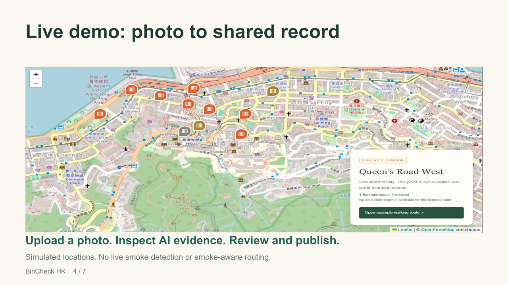

# BinCheck HK

**Find the right bin. See the evidence.**

AI-assisted cigarette-disposal facility discovery and evidence review in Hong Kong.
Built by **David (Phat Dat Nguyen) and Biruk** for **Nova Youth 2026, HKU Station**.
**Bronze award**, as reported by the team after the competition on 14 November 2026.

[Live prototype](https://bincheck-hk-nova-david.lonehoop2.chatgpt.site) · [Architecture](docs/ARCHITECTURE.md) · [Setup](docs/SETUP.md) · [CV / portfolio](docs/PORTFOLIO.md) · [Pitch deck](docs/presentation/BinCheck-HK-Pitch.pptx)



## The problem

A generic rubbish-bin marker does not establish whether a cigarette tray exists, whether a facility has moved, or what evidence supports the record. BinCheck HK combines a map with photographic observations and human-reviewed updates.

The implemented use case is adults looking for suitable disposal facilities in an unfamiliar area. A proposed second use case is people seeking to avoid secondhand smoke. **The app does not currently detect smoke or compute smoke-aware routes.** A bin pin does not establish smoking activity or permission to smoke.

## Working prototype

- **Public map:** Leaflet / OpenStreetMap, street-name filtering, browser geolocation, straight-line distance estimates and external walking-direction links.
- **Photo contributions:** team members upload JPG/PNG/WebP photos, add coordinates, or report facilities as present, missing, moved or obstructed.
- **AI assistance:** an explicit Analyze Photo action requests a structured category and visual evidence; the assessment is saved for that upload. Unavailable AI falls back to manual review.
- **Human approval:** a protected queue lets the team approve or reject observations before publication while retaining observation history.
- **Shared persistence:** Supabase PostgreSQL and private photo storage behind server routes that enforce team access.
- **Usability:** dismissible map details, responsive layout, a cached last-loaded public list and offline indication; writes pause offline.
- **Rules introduction:** concise smoking-rule information linked to official Hong Kong sources.

**Demo boundary:** 10 simulated seed points around Sai Ying Pun / HKU. New and approved demo submissions remain labelled simulated. This is a working workflow demonstration, not a verified citywide facility directory.

## Technology

| Layer | Implementation |
| --- | --- |
| Interface | React 19, TypeScript, CSS / Tailwind |
| Runtime | Vinext, Next.js-style routes, Vite, Cloudflare Workers |
| Maps | Leaflet and OpenStreetMap tiles |
| Records / evidence | Supabase PostgreSQL and Storage |
| AI | Server-side vision request through a model gateway |
| Access | Shared team code, signed HttpOnly cookie, origin checks, request limits |

The starter also retains a D1/R2 backend path. The competition deployment used Supabase. Individual Supabase Auth accounts are future work.

## Run locally

Requires **Node.js 22.13+** and your own Supabase configuration.

```sh
git clone https://github.com/phatdat220707/NovaYouthProject.git
cd NovaYouthProject/web
npm ci
```

Copy `web/.dev.vars.example` to `web/.dev.vars`, fill server settings privately, then run:

```sh
npm run dev
```

Open the exact URL printed in the terminal. [Setup instructions](docs/SETUP.md) cover SQL preparation, model configuration and hosting. Without backend settings the page shell can render, but persistent map records and team actions require a configured backend.

## Repository guide

| Path | Contents |
| --- | --- |
| `web/` | Application source, runtime helpers and lockfile |
| `supabase/setup.sql` | New-project database / storage setup; matches the copy under `web/` |
| `docs/ARCHITECTURE.md` | Data flow, endpoints and tradeoffs |
| `docs/SETUP.md` | Reproduction and hosting notes |
| `docs/PROJECT_SUMMARY.md` | Outcome, current scope and roadmap |
| `docs/PORTFOLIO.md` | English CV bullets and interview wording |
| `docs/VALIDATION.md` | Historical evidence and current checks |
| `docs/SECURITY.md` | Access boundaries and known hardening work |
| `docs/ATTRIBUTION.md` | Third-party assets and source links |
| `docs/presentation/` | Seven-slide competition deck and speaker notes |
| `docs/archive/` | Original planning documents, not current product claims |

## Outcome and limits

The team received **Bronze at Nova Youth 2026, HKU Station**. This is based on the team's report; an organiser-issued certificate or results URL is not attached. Qualification for a Shenzhen final has **not** been confirmed.

The prototype demonstrates the evidence-to-review workflow. User demand, bin-classification accuracy, litter reduction, smoke-exposure reduction and health benefits remain unvalidated. Government health/environment funding is a **proposed** model; no funding or paying customers are confirmed. Public contribution, individual accounts and smoke-awareness features are future work.

## Team and provenance

David worked on implementation and integration with AI coding assistance. Biruk contributed to problem refinement and delivered the pitch. The product builds on an existing Vinext / Sites starter; third-party framework code is not presented as original team work.

The live demo depends on its original deployment and external services, with no availability guarantee. Read the [security notes](docs/SECURITY.md) before operating a public contribution service. Never commit credentials or filled environment files.
