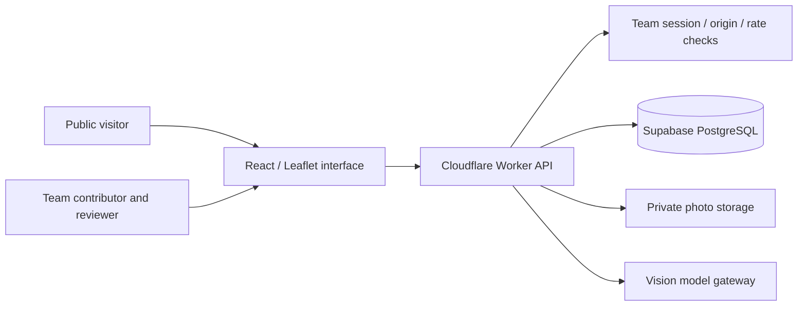

# Architecture

## Evidence lifecycle

1. A team member selects a photo. Selecting it alone does not call AI.
2. Analyze Photo posts to `/api/assess`. The server validates size and JPEG/PNG/WebP signatures, calls the model, stores the photo and saves an assessment.
3. `/api/submissions` creates a pending observation and, for new locations, a pending facility. Existing-facility change reports may be note-only.
4. The review queue presents pending evidence. Approval updates the facility and records a decision; rejection does not publish a new facility.
5. Public visitors see reviewed records and approved evidence. Approval preserves the demo flag.

## Endpoints

| Route | Methods | Purpose / access |
| --- | --- | --- |
| `/api/session` | GET, POST, DELETE | Session inspection, team-code login and logout |
| `/api/facilities` | GET | Public reviewed data; pending data for team |
| `/api/photos/:id` | GET | Approved evidence publicly; pending evidence for team |
| `/api/assess` | POST | Team-only validation, AI analysis and storage |
| `/api/submissions` | POST | Team-only new / changed observations |
| `/api/reviews` | GET, POST | Team-only review queue and decisions |

Implementation: `web/lib/server.ts`, `web/lib/supabase-store.ts`, `web/app/TeamWorkspace.tsx`.

## Data model

- `facilities`: coordinates, type, status, current photo and demo flag.
- `observations`: facility, optional photo, report type, note, review state and timestamps.
- `photos`: object reference, MIME type and saved assessment.
- `attempts`: request-limit counters.
- `profiles`: schema groundwork for future accounts, not a shipped signup system.

## Design tradeoffs

- Leaflet/OSM avoids a paid map key. Public tiles require connectivity and their usage policy applies. Distances are straight-line estimates, not pedestrian-route lengths.
- Supabase supports shared records and private images. The privileged server key bypasses RLS, making server authorization essential.
- The shared team code is expedient for a demonstration but does not distinguish contributors from reviewers.
- AI returns one of five categories and short evidence, always requiring human review. It cannot prove location, date, authenticity, permission or availability.
- The vision endpoint/model are fixed in the prototype source. Another provider needs request-format compatibility checks.
- The Supabase adapter uses sequential REST operations for batches, not one transaction. Production work must address partial failure and concurrent review races.
- Offline support caches the last public list only; it does not provide offline tiles, routing or writes.
- The D1/R2 code path remains from the starter. The committed hosting manifest does not configure those bindings.
